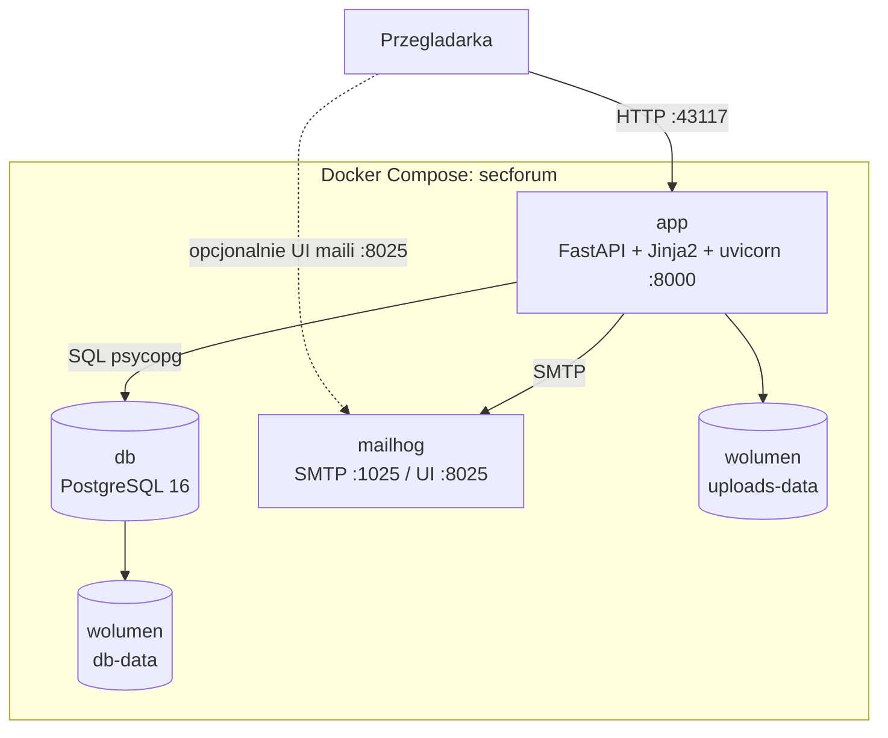
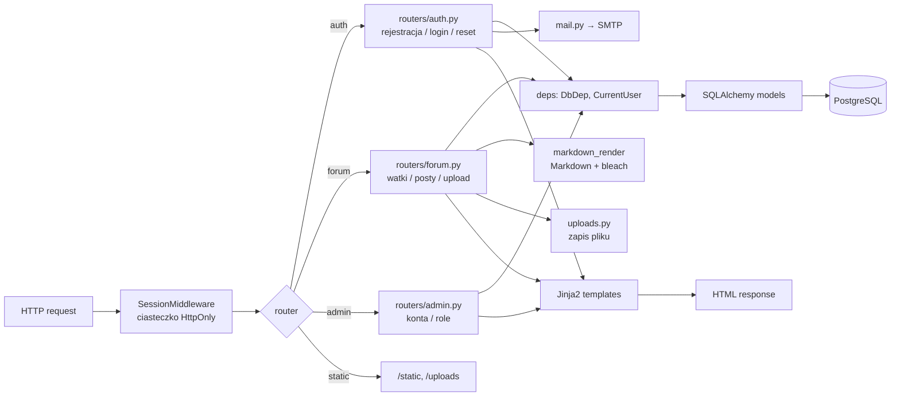
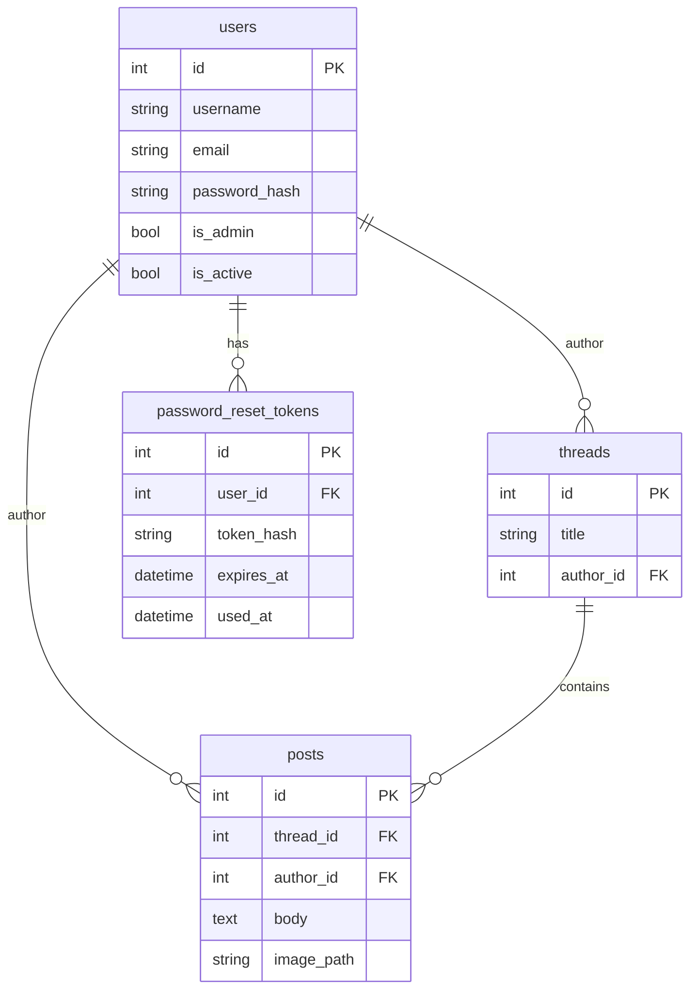

# Architektura Folium (stan L2)

## 1. Schemat blokowy srodowiska DEV



Cale srodowisko: `docker compose up --build -d`. Konfiguracja przez zmienne
srodowiskowe (`APP_SECRET_KEY`, `APP_DATABASE_URL`, `APP_SMTP_*`, `APP_UPLOAD_DIR`).

## 2. Schemat dzialania aplikacji (request)



## 3. Glowne przeplywy

### 3.1 Logowanie / sesja

1. `POST /login` → weryfikacja Argon2 → `session["user_id"]` w podpisanym ciasteczku.
2. Kolejne requesty: `SessionMiddleware` → `deps.CurrentUser` laduje `User` z bazy.
3. Brak stanu w pamieci procesu (mozna skalowac za LB bez sticky sessions).

### 3.2 Watek / odpowiedz z formatowaniem

1. Toast UI Editor (WYSIWYG) w przegladarce → Markdown w ukrytym `textarea`.
2. Obraz: `POST /api/uploads` → plik w `/srv/uploads` → URL `/uploads/...`.
3. `POST /threads/new` lub `POST /threads/{id}/posts` zapisuje Markdown w `posts.body`.
4. Przy wyswietlaniu: filtr Jinja `| md` → HTML (bleach).

### 3.3 Reset hasla

1. `POST /forgot-password` → token w `password_reset_tokens` (hash) → mail SMTP.
2. W DEV mail ląduje w Mailhog (`:8025`).
3. `POST /reset-password` → nowe haslo (Argon2), token `used_at`.

### 3.4 Admin

1. `require_admin` na `/admin` i kasowaniu.
2. Dezaktywacja konta / nadanie admina; kasowanie watkow i postow z widoku watku.

## 4. Model danych



## 5. Struktura kodu

```
app/
  main.py              FastAPI, sesja, static/uploads, routery
  config.py            env
  db.py / models.py    SQLAlchemy
  deps.py              DbDep, CurrentUser, require_admin
  mail.py              SMTP
  uploads.py           zapis obrazkow
  markdown_render.py   Markdown → bezpieczny HTML
  templating.py        Jinja2
  routers/
    auth.py            rejestracja, login, reset
    forum.py           board, watki, upload, delete
    admin.py           panel admina
  templates/           HTML
  static/              CSS, composer.js, logo
```

## 6. Docelowo Azure (L3/L4 — plan)

```
Internet → Azure DNS → Application Gateway (TLS/WAF)
                         → Container Apps (obraz z ACR)
                         → Azure Database for PostgreSQL
```

Mapowanie: `app` → Container Apps, `db` → Flexible Server, SMTP → SendGrid/ACS,
uploady → Azure Blob (plan). Szczegoly: [`infra/azure/README.md`](../infra/azure/README.md).
